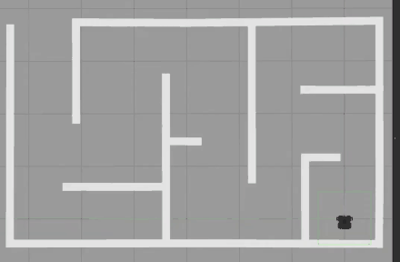
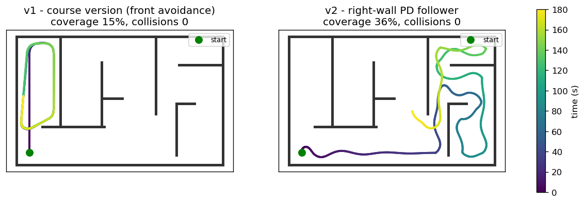

# TurtleBot3 Wall Follower (ROS Noetic + LiDAR + PID)

A ROS node that drives a TurtleBot3 through a maze using its 360° LiDAR, plus a small
2D simulator so the controllers can be run and measured without ROS or Gazebo.

[](https://github.com/abdullahyousaf-dev/turtlebot3-wall-follower/actions/workflows/tests.yml)




## Highlights

- **v2 controller tracks the wall within 8.7 cm** on average (v1: 28.9 cm), zero collisions
- **2.4× maze coverage** (36 % vs 15 %) from a right-wall-following strategy
- Gains tuned by a **16-point kp/kd sweep** in a ray-cast LiDAR simulator that needs no ROS

## Results

Same maze layout as the Gazebo world, 3 minutes of simulated time, LDS-01 LiDAR model
(0.12–3.5 m, 1 cm noise), TurtleBot3 Burger radius 0.105 m.

| Metric | v1 | v2 |
|---|---|---|
| Collisions | 0 | 0 |
| Closest approach to a wall | 4.1 cm | **20 cm** |
| Mean right-wall tracking error | 28.9 cm | **8.7 cm** |
| Time spent 0.3–0.7 m from a wall | 40 % | **100 %** |
| Maze coverage (0.5 m cells visited) | 15 % | **36 %** |



## How it works

| | v1: course version | v2: right-wall follower |
|---|---|---|
| Idea | Drive straight; when the ±20° front sector is closer than 0.55 m, slow down and turn right with a PD term | Hold 0.45 m to the wall on the right using the −90° and −45° beams; turn left at inside corners, arc right when the wall ends |
| Sensors used | front sector | front, right, front-right sectors |
| Shown in the GIF | yes | added later, tested in the simulator |

v1 is the controller from the course project, with one fix: the derivative term
divided by `dt` on the first message, where `dt = 0`. v1 only ever turns right, so
in a maze it tends to circle the first corridor it enters; v2 came out of studying
that behaviour in the simulator.

*Mobile Robotics course project, MS Robotics & Intelligent Machine Engineering, NUST
(2024). Built and tested in ROS Noetic and Gazebo 11 on a custom maze world.*

## Quick start

**Without ROS** (any OS, Python 3.9+):

```bash
pip install -r requirements.txt
python sim/run_sim.py      # prints the table above, saves media/sim_paths.png
python -m pytest -q        # 6 tests
```

**With ROS Noetic** (Ubuntu 20.04): copy `ros/wall_follow_turtlebot` into
`~/catkin_ws/src`, then:

```bash
cd ~/catkin_ws && catkin_make && source devel/setup.bash
export TURTLEBOT3_MODEL=burger
roslaunch wall_follow_turtlebot wall_follow.launch controller:=v2
```

## Project structure

```
ros/wall_follow_turtlebot/       catkin package
  scripts/wall_follow.py         ROS node: /scan -> controller -> /cmd_vel
  scripts/wall_follower_core.py  PID + both controllers, no ROS imports
  launch/wall_follow.launch
sim/simulator.py                 maze, ray-cast LiDAR, unicycle model, collision check
sim/run_sim.py                   comparison table and plots
tests/                           LiDAR geometry, controller behaviour, collision-free runs
legacy/                          the original node as submitted
```

## Design notes

- The controller logic lives in `wall_follower_core.py` with no ROS imports, so the
  same code runs in the ROS node, the simulator and the tests.
- The v2 gains (kp 2.2, kd 1.4) gave the lowest tracking error with no collisions in
  the sweep.

## Limitations & next steps

- The simulator is 2D and kinematic (no wheel slip or inertia)
- Next: run v2 in Gazebo and on a real TurtleBot3, and add SLAM-based exploration

## License

MIT. See [LICENSE](LICENSE).

**Keywords:** ROS, ROS Noetic, TurtleBot3, Gazebo, LiDAR, wall following, PID control,
mobile robotics, autonomous navigation, obstacle avoidance, ray casting, Python, NumPy.
